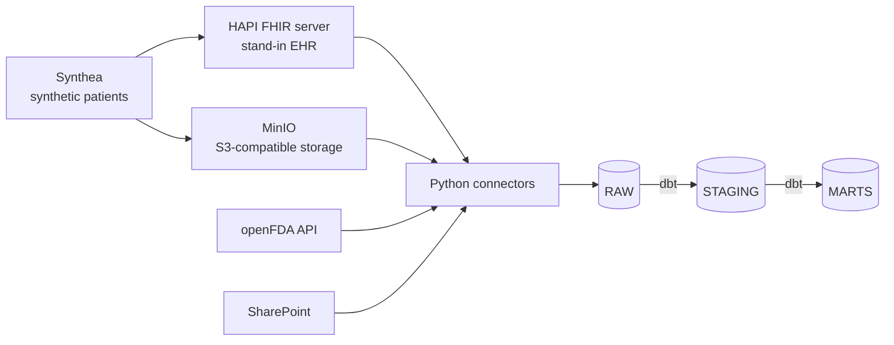

# Clinical Intelligence Platform

A data and AI platform for a fictional hospital, built entirely on synthetic and public data.

The goal is to show the full path a healthcare AI system takes in practice: pulling data
out of separate hospital systems, landing it in a tested warehouse, and then building
machine learning models and LLM services on top of it.

> **Status: v0.1 in progress.** Local infrastructure is running and synthetic patients
> are loaded into the FHIR server. Connectors, warehouse and dbt models are next.

## Architecture (v0.1 target)



Each source mirrors a real integration pattern found in hospitals:

| Source | Stands in for | Integration pattern |
| --- | --- | --- |
| HAPI FHIR server | An electronic health record (e.g. Epic, Oracle Health) | REST API, pagination, incremental loads |
| MinIO | Cloud object storage (Amazon S3, Azure Blob) | Scheduled file drops |
| openFDA | External public data | Rate-limited public API |
| SharePoint | Enterprise document stores | OAuth2, document sync |

## Progress

- [x] Repo structure, `pyproject.toml`, Git
- [x] Python 3.12 virtual environment with all dependencies
- [x] Docker Compose stack: HAPI FHIR (R4) and MinIO
- [x] Synthetic data: 100 patients generated with Synthea (fixed seed for reproducibility)
- [x] Patients loaded into the FHIR server (`scripts/load_fhir.py`)
- [ ] Billing files uploaded to MinIO
- [ ] Snowflake setup (roles, schemas, key-pair auth) with DuckDB fallback
- [ ] Connector framework and four connectors
- [ ] dbt staging and mart models with tests
- [ ] Dagster orchestration
- [ ] CI with GitHub Actions

## Engineering notes

Problems hit during setup, and how they were solved:

- **MinIO community image removed.** The `minio/minio` image is no longer published on
  Docker Hub, so pulls fail with "access denied". Replaced it with
  `cgr.dev/chainguard/minio`. Locally it runs as root (`user: "0:0"`) to avoid volume
  permission issues; a production deployment would use a non-root user with correct
  volume ownership.
- **FHIR server out of memory during bulk load.** HAPI's JVM ran out of heap
  (`Java heap space`), which closed its embedded H2 database and failed every later
  request. Fixed by raising the heap limit (`JAVA_TOOL_OPTIONS=-Xmx3g`) and Docker's
  memory allocation, then recreating the container.
- **Loader too fragile.** The first loader stopped at the first dropped connection. The
  current version waits for the server's `/metadata` endpoint before loading, retries
  dropped uploads, and reports failures at the end instead of aborting.
- **Environment conflicts.** A conda `base` environment and the project's `.venv` were
  active together, so packages installed into one and were imported from the other.
  Disabled conda auto-activation and rebuilt the venv on Python 3.12 (data tooling such
  as dbt lags behind the newest Python releases).

## Running it locally

Prerequisites: Docker Desktop, Python 3.12, Java 17+ (for Synthea), Git.

```bash
# Environment
python3.12 -m venv .venv
source .venv/bin/activate
python -m pip install -e ".[dev]"
cp .env.example .env

# Services
docker compose up -d
docker compose ps

# Synthetic data (100 patients, fixed seed)
mkdir -p data/synthea && cd data/synthea
curl -LO https://github.com/synthetichealth/synthea/releases/download/master-branch-latest/synthea-with-dependencies.jar
java -jar synthea-with-dependencies.jar -p 100 -s 42 \
  --exporter.csv.export=true --exporter.fhir.transaction_bundle=true \
  --exporter.baseDirectory=./output Massachusetts
cd ../..

# Load into FHIR
python scripts/load_fhir.py
```

Check it worked:

- FHIR patient count: http://localhost:8080/fhir/Patient?_summary=count
- MinIO console: http://localhost:9001

## Roadmap

| Release | Scope |
| --- | --- |
| v0.1 | Data platform: four sources, Snowflake, dbt, Dagster, CI |
| v0.2 | Readmission and length-of-stay models (MLflow, Optuna) |
| v0.3 | Clustering, anomaly detection, recommendations |
| v0.4 | LLM services with evaluation sets |
| v0.5 | Synthetic clinical notes dataset and fine-tuning |
| v1.0 | Serving, monitoring, dashboard, documentation |

## Data and privacy

All data is synthetic (Synthea, CMS DE-SynPUF) or public (openFDA).
No real patient data is used anywhere in this repository. Generated data is git-ignored.
This is a portfolio project, not a medical device.
